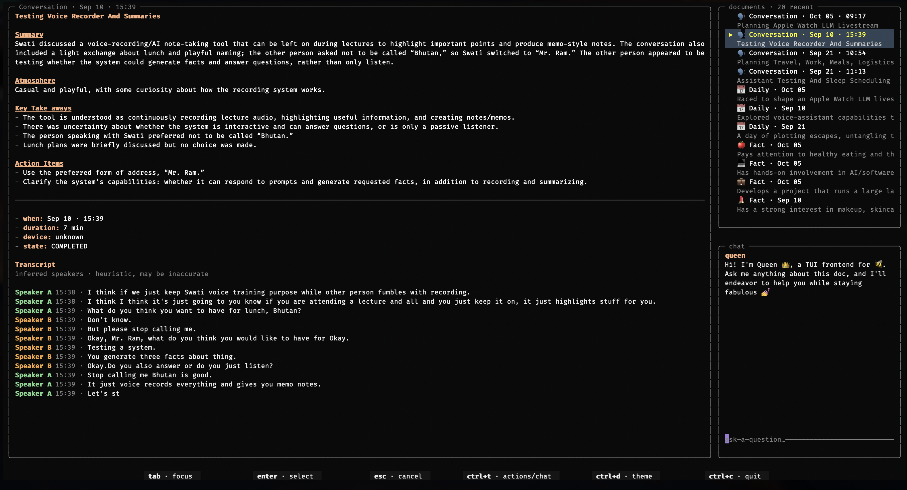
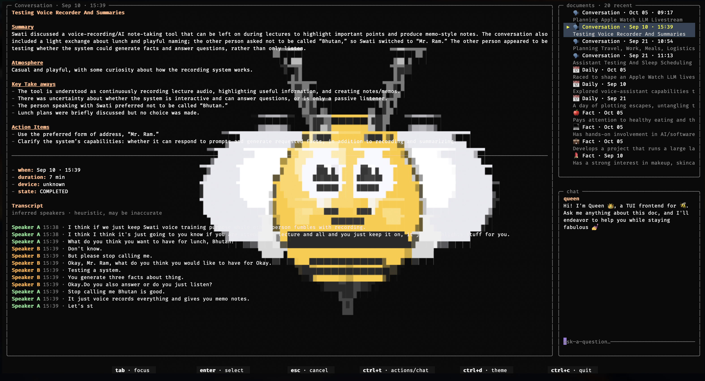

👑 Queen
========

A beautiful agentic way to garner insights from your Bee Wearable or Bee App.
Based on and pulls the latest ``bee-cli``. Originally built for the Amazon Developer Hackathon c.2026.

Dependencies
------------

``bee-cli`` is pinned by the parent commit. ``elthur`` is my GGUF inference package and is kept on the latest commit.
**All upstream changes are propagated** this ensures the latest versions of both, while maintenance is a clear separation of concerns. 
``main`` by the build (``git submodule update --remote``); to freeze a release, build with ``QUEEN_NO_ELTHUR_UPDATE=1`` and commit the resulting gitlink. 
Both revisions are baked into the binary at build time and shown by ``queen status``.

Notes
------
Parts of the codebase have been AI generated. Nearly all generated code is reviewed by me and there are also comprehensive unit tests in order to mitigate any breakages.
None of the text or the submission to the actual hackathon entry is AI generated.

Run TUI
--------
The macOS TUI is shipped in Releases. Download and place the macOS binary in ``usr/local/bin`` or any other folder. For Linux, use the Docker image below.
Then run like you would any other executable. It is codesigned with my Apple Developer Id, though MacOS verification takes some time on first launch.

.. code-block:: bash

   chmod +x ./queen
   ./queen

Run CLI
--------

While a bare ``queen`` opens the TUI. Any argument — or piped stdin — runs a single command, prints one card, and exits.
Plain text commands are agent interpreted (locally) and keywords commands execute the same way as they would in Bee CLI.

.. code-block:: bash

   ./tui/dist/queen status
   ./tui/dist/queen todos create --text "buy milk"
   ./tui/dist/queen "show latest todo"
   echo "what did I say about the budget" | ./tui/dist/queen

Recognized subcommands are derived from the pinned ``bee-cli`` registry, so every resource (``todos``, ``facts``, ``insights``, ``journals``, ``conversations``,
``locations``, ``search``, …) works. Free text is resolved cheaply: information questions go to Bee search, list/latest reads are deterministic, and actions use
one local-model tool-selection turn. Ambiguous requests fail fast with a card of runnable suggestions instead of guessing.

Docker (note: untested)
-------------------------

The multi-arch image is published as ``ghcr.io/bitanath/queen-bee:latest`` for
``linux/amd64`` and ``linux/arm64``. Mount ``~/.bee`` to reuse your Bee
credentials; without it, generic chat works, but Bee reads and actions are not
authenticated.

.. code-block:: bash

   docker pull ghcr.io/bitanath/queen-bee:latest

TUI
~~~

.. code-block:: bash

   docker run --rm -it -v "$HOME/.bee:/root/.bee" ghcr.io/bitanath/queen-bee:latest

CLI
~~~

.. code-block:: bash

   docker run --rm -v "$HOME/.bee:/root/.bee" ghcr.io/bitanath/queen-bee:latest status
   docker run --rm -v "$HOME/.bee:/root/.bee" ghcr.io/bitanath/queen-bee:latest "show latest todo"

On Apple Silicon, add ``--platform linux/amd64`` to run the amd64 image through
Rosetta; omit it (or use ``--platform linux/arm64``) for native arm64.

To build and push the multi-arch image yourself:

.. code-block:: bash

   ./img.sh build

First launch is slow
--------------------

The model is embedded in the executable, so macOS verifies the entire signed
file. Subsequent launches will be way faster.

Build from Scratch (MacOS only)
--------------------------------

Requires Apple Silicon macOS, Bun, Xcode command line tools, and
``tui/libelthur.dylib``.

.. code-block:: bash

   git clone https://github.com/bitanath/queen.git
   cd queen
   git submodule update --init bee-cli
   ./models/download.sh #download the LFM model, or any other supported model like Qwen 3.5 4B etc
   ./build.sh --dylib tui/libelthur.dylib #build using the provided dylib

Credentials
-----------

Tokens are stored as dotfiles under ``~/.bee/`` (``token-<env>``, mode 0600) rather than the macOS Keychain. The binary is re-signed on every build, so the
Keychain would prompt for your login password on each launch.

License
-------

Queen is free to use under the Apache License 2.0; see ``LICENSE``. The project itself does not charge for use and will never hit the LFM 2.5 limit of USD 10M
commercial usage allowed. However, LFM does have a commercial usage cap of USD 10M.

The embedded LFM2.5 model weights remain under the
`LFM Open License v1.0 <https://huggingface.co/LiquidAI/LFM2.5-2.6B-GGUF/blob/main/LICENSE>`_.

